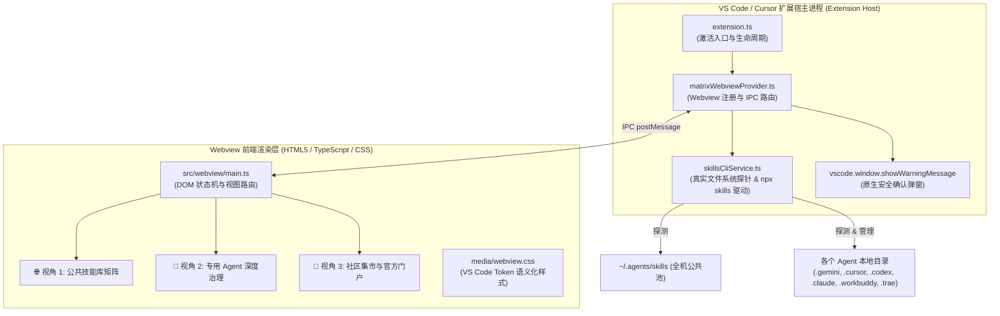

# 🤖 Agent Skills Matrix — 智能体协作与工程指南 (AGENTS.md)

> 本文档是为所有参与本项目的 AI 编码智能体（Antigravity、Cursor、Codex、Claude Code、Trae 等）制定的最高指导原则与工程规范。**任何在此工程中进行修改、扩展或维护的智能体必须无条件遵循本文件所有准则。**

---

## 📌 1. 项目核心使命与愿景

### 1.1 痛点背景
在多智能体混合开发的本地环境（Antigravity、Cursor、Codex、Claude Code、WorkBuddy、Trae）中，各个智能体的技能（Skills）体系极易产生混乱：
- 官方 `npx skills` CLI 工具存在误判漏洞，将包含公共目录的 Agent 一律上报为挂载全量技能（`isUniversalAgent` 假象）；
- 许多 Agent 自行克隆了私有实体技能（独苗），导致公共池与私有目录脱节；
- 软链失效死链频发、SKILL.md 缺少中文语义化描述、缺乏直观的跨 Agent 开关矩阵与集市一键安装能力。

### 1.2 解决方案
**Agent Skills Matrix** 是一款生产级 VS Code / Cursor 扩展，基于物理文件系统底层真值校验（Ground Truth），提供：
1. **🌐 公共技能库透视**：跨 Agent 的二维装配矩阵，支持一键切换、全选批量挂载与死链清理。
2. **🤖 专用 Agent 深度治理**：
   - 🟠 **分区一（私有实体技能）**：独苗一键收编入公共池、冗余实体一键转软链、安全删除独苗。
   - 🟢 **分区二（公共池选配）**：支持全部/已启用/未启用胶囊过滤，实时挂载/卸载。
   - 🔒 **分区三（系统与插件技能）**：只读安全浏览与源码阅读。
3. **🛒 技能集市 (Marketplace)**：社区高星精选技能包一键安装，并集成官方 `skills.sh` 门户直通。

---

## 🏷️ 2. 核心铁律：版本管理与更新规范 (Versioning Protocol)

> [!IMPORTANT]
> **每次更新必升版本号（Mandatory Version Bump）**：
> 无论改动规模大小（包括特性新增、Bug 修复、样式调整或依赖变更），**每次提交和交付之前，必须严格执行以下版本流**：

### 2.1 语义化版本规则 (SemVer)
- **Patch (补丁) `0.2.x`**：单个 Bug 修复、文案微调、小范围样式对齐。
- **Minor (次版本) `0.x.0`**：新增 Agent 支持、新功能分区（如集市视图）、架构升级、向后兼容的新增 API。
- **Major (主版本) `x.0.0`**：破坏性改动、UI 核心交互重大颠覆、底层重写。

### 2.2 更新闭环 Checklist
1. **递增版本号**：修改 `package.json` 中的 `"version": "x.y.z"`。
2. **登记变更记录**：在本文件的 [## 7. 变更日志 (Changelog)](#-7-变更日志-changelog) 底部追加详细更新内容与影响面。
3. **重新编译打包**：
   ```bash
   npm run compile && npm run type-check
   npx @vscode/vsce package --no-dependencies
   ```
4. **验证与热重载安装**：
   ```bash
   cursor --install-extension agent-skills-matrix-<version>.vsix --force
   "/Applications/Visual Studio Code.app/Contents/Resources/app/bin/code" --install-extension agent-skills-matrix-<version>.vsix --force
   ```
5. **Git 提交并附带版本号标签**：
   ```bash
   git commit -m "release: v<version> - <核心变更摘要>"
   ```

---

## ⚠️ 3. 血泪工程陷阱与避坑指南 (Ground-Truth Pitfalls)

在此工程中编码时，必须牢记以下四项经生产环境血泪验证的铁律，严禁重蹈覆辙：

### 陷阱 1：`npx skills list --json` 的 `isUniversalAgent` 假象
- **现象**：`npx skills` 将任何拥有 `~/.agents/skills` 的 Agent 标记为 universal，虚假报告该 Agent 已挂载了全量技能。
- **铁律**：**永远不能轻信 CLI 输出**。必须在 `SkillsCliService.ts` 中通过 `safeLstat(agentSkillDir)` 对物理软链与实体文件进行真实检验，以文件系统底层状态作为唯一权威依据。

### 陷阱 2：VS Code / Electron Webview 对模态弹窗的静默吞没
- **现象**：Webview 沙箱环境直接调用 `window.confirm()`、`window.alert()` 或 `window.prompt()` 时，会被 Electron 静默丢弃（始终返回 `false`），导致删除独苗等危险操作完全无法点击触发。
- **铁律**：**所有交互确认必须通过 IPC 委托给扩展主进程**。Webview 发送 `{ type: 'deletePrivateSkill' }`，由 `matrixWebviewProvider.ts` 调用 VS Code 原生 API `vscode.window.showWarningMessage('...', { modal: true })` 进行强提示确认。

### 陷阱 3：Node.js CLI 进程调用 DEP0190 弃用警告与无交互限制
- **现象**：在 `childProcess.spawn('npx', ...)` 时若设置 `shell: true`，会触发 Node.js DEP0190 安全警告，且在无虚拟终端时可能发生死锁或悬挂。
- **铁律**：始终使用 `{ shell: false }`，配置独立环境变量（提取正确的 PATH），并挂载超时中断保护（如 15 秒超时强杀），通过流式 Buffer 聚合输出。

### 陷阱 4：不存在路径的 `fs.lstatSync` 抛出 `ENOENT`
- **现象**：直接调用 `fs.lstatSync(targetPath)` 在路径不存在时会抛出未捕获异常中断主事件循环，导致前端弹出红色错误气泡。
- **铁律**：所有文件状态探测必须统一封装在 `safeLstat(p)` 中：捕获异常并安全返回 `null`。

---

## 🏗 4. 架构设计与模块分工



### 关键文件导航
- [src/extension.ts](file:///Users/defuxu/Documents/agent%20skills%20matrix/src/extension.ts)：插件激活入口、命令注册 (`agent-skills-matrix.refresh`, `open`)。
- [src/services/skillsCliService.ts](file:///Users/defuxu/Documents/agent%20skills%20matrix/src/services/skillsCliService.ts)：物理文件系统真值探测、YAML 语法容错解析、私有独苗收编与软链转接、`npx skills` 命令桥接。
- [src/views/matrixWebviewProvider.ts](file:///Users/defuxu/Documents/agent%20skills%20matrix/src/views/matrixWebviewProvider.ts)：Webview 视图容器、安全 CSP 配置、主进程 IPC 消息路由、原生 Modal 拦截与确认。
- [src/webview/main.ts](file:///Users/defuxu/Documents/agent%20skills%20matrix/src/webview/main.ts)：Webview 客户端渲染逻辑、乐观更新、分类过滤与事件监听。
- [src/types/skills.ts](file:///Users/defuxu/Documents/agent%20skills%20matrix/src/types/skills.ts)：跨进程数据类型契约与 IPC 通信协议定义。
- [src/types/descriptions.ts](file:///Users/defuxu/Documents/agent%20skills%20matrix/src/types/descriptions.ts)：标准 Agent 技能全中文语义化功能描述字典。
- [src/types/marketplace.ts](file:///Users/defuxu/Documents/agent%20skills%20matrix/src/types/marketplace.ts)：精选开源技能集市元数据表。
- [media/webview.css](file:///Users/defuxu/Documents/agent%20skills%20matrix/media/webview.css)：全响应式、完全适配 VS Code 浅色/深色主题的样式规范。

---

## 🛠️ 5. 本地开发与交付常用指令

```bash
# 1. 启动 TypeScript + esbuild 实时监听构建
npm run watch

# 2. 静态类型检查（修改代码后必跑）
npm run type-check

# 3. 生产级单文件打包
npm run compile

# 4. 打包为 vsix 安装包
npx @vscode/vsce package --no-dependencies

# 5. 一键安装更新到 Cursor 与 VS Code
cursor --install-extension agent-skills-matrix-0.2.0.vsix --force
"/Applications/Visual Studio Code.app/Contents/Resources/app/bin/code" --install-extension agent-skills-matrix-0.2.0.vsix --force
```

---

## 🎨 6. UI 与交互设计准则

1. **主题自适应**：严禁硬编码颜色值（如 `#ffffff` 或 `#000000`）。必须使用 VS Code 官方 CSS 变量（`var(--vscode-editor-background)`, `var(--vscode-foreground)`, `var(--vscode-button-background)` 等）。
2. **极速响应与乐观更新 (Optimistic UI)**：点击 ON/OFF 开关时，先立刻更新界面样式与计数，后台异步发送 IPC；若失败则触发 Toast 提示并自动回滚。
3. **安全操作二次确认**：涉及物理删除、破坏性清理等不可逆操作，绝不可直接执行，必须弹窗给用户明确的选择权。
4. **清晰的信息分层**：
   - 绿色 `●` 表示正常挂载的软链；
   - 橙色 `●` 表示未入库的独苗私有文件夹；
   - 红色 `⚠️` 表示宿主文件已缺失的失效死链；
   - 灰色 `○` 表示公共池收录但该 Agent 当前未挂载。

---

## 📜 7. 变更日志 (Changelog)

### v0.5.5 (2026-11-07)
- **Docs**: README 增加用户提供的实际界面截图。

### v0.5.4 (2026-11-07)
- **Docs**: 在 README 顶部增加中文项目介绍、主要功能与安装说明。

### v0.5.3 (2026-11-07)
- **Docs**: 更新 README 的功能、支持目录、安装方式与限制，移除过时和未经验证的表述。

### v0.5.2 (2026-11-07)
- **UX**: 侧栏使用紧凑布局，简化导航、分区和技能行；编辑器大面板保留完整操作。

### v0.5.1 (2026-11-07)
- **UX**: 根据宿主识别 Antigravity 或 Cursor，默认打开对应视图并将其排在项目和公共技能库之前；其他宿主默认显示当前项目。

### v0.5.0 (2026-11-07)
- **Feat**: 新增当前项目技能视图，按工作区扫描 `.github/skills`、`.agents/skills` 和 `.claude/skills`，支持搜索与只读查看。

### v0.4.3 (2026-11-07)
- **Fix**: 状态栏 Skills Matrix 按钮直接打开编辑器主区域管理面板。

### v0.4.2 (2026-11-07)
- **UX**: 侧栏标题栏提供“在编辑器区域打开”入口；活动栏命令与大面板命令分离。

### v0.4.1 (2026-11-07)
- **Feat**: 保留活动栏入口，打开命令在编辑器主区域创建完整管理面板。

### v0.3.9 (2026-11-07)
- **Fix**: 将 Skills Matrix 容器恢复到活动栏，保留底部宽面板中的视图入口。

### v0.3.8 (2026-11-07)
- **Fix**: Windows 下通过 Node.js 直接运行 npm 的 npx-cli.js，保持 shell 关闭并使用超时中断。
- **Fix**: Agent 仅在技能目录实际存在时标记为已发现；Copilot 优先识别 `.github/skills`。
- **Fix**: Codex 插件标签从缓存路径正确提取插件名，处理带版本层级的 curated 插件。

### v0.3.7 (2026-11-07)
- **UX**: 将 Skills Matrix 容器放入底部面板，打开命令直接聚焦视图，使用更宽的工作区展示矩阵。

### v0.3.6 (2026-11-07)
- **UX**: 统一按名称对公共技能及所有 Agent 的私有、公共池和内置／插件技能列表排序。

### v0.3.5 (2026-11-07)
- **UX**: Codex 插件技能显示带插件前缀的名称及原始描述；内置和插件列表支持名称、来源与描述搜索并按名称排序。
- **Fix**: 保留专属视图各分区的折叠状态，搜索内置技能时自动展开并显示匹配数量。

### v0.3.4 (2026-11-07)
- **Fix**: 比较公共软链接目标以支持安全去重；优先识别失效链接。
- **Fix**: 安装未发现新增技能时允许用户选择已有公共技能并挂载到指定 Agent。

### v0.3.3 (2026-11-07)
- **Fix**: 转义技能和通知内容，防止外部数据破坏 Webview 标记；专属视图区分同名冲突和失效链接。
- **Fix**: 已挂载链接重复启用时保持原状；公共技能删除报告部分失败并刷新状态。

### v0.3.2 (2026-11-07)
- **Fix**: 分别展示本地技能条目和发现的内置及插件条目，避免将扫描结果误称为活跃总数。
- **UX**: 公共矩阵冻结技能名称列；查看源码时依次查找常见入口，缺失时定位技能目录。

### v0.3.1 (2026-11-07)
- **Fix**: 校验软链接目标，保护同名外部链接；去重前比较内容并保留备份，收编失败时恢复原目录。
- **Fix**: 批量操作报告逐项失败；安装依据新增技能报告挂载结果，避免将未知结果报告为成功。

### v0.3.0 (2026-11-07)
- **Feat**: 新增对 **GitHub Copilot** (`~/.copilot/skills` / `~/.github/skills`) 的官方第一类 Agent 纳管支持。
- **Feat**: 深度适配 **Cursor** 内置/托管技能体系（扫描 `~/.cursor/skills-cursor`，自动解析 `.cursor-managed-skills-manifest.json`，识别 20 个 Cursor Built-in & Managed 技能）。
- **Feat**: 深度细化 **Codex** 系统与生态插件（展开 `.system` 5 个核心系统技能，深度扫描 `~/.codex/plugins/cache` 识别 52 个 OpenAI 官方生产力、设计套件与商业战略模板技能）。
- **Feat**: 深度适配 **WorkBuddy** 内部生态（解析 `~/.workbuddy/.skill-list-cache.json` 与插件缓存，识别 61 个企微连接器、腾讯文档、微信支付与系统内置技能）。
- **Feat**: 深度重构 **Hermes Agent** 技能发现引擎（精准区分顶层直接实体技能与分类内置库，递归展开 MLOps、DevOps、研发自测等 56 个分类内置技能）。

### v0.2.0 (2026-11-07)
- **Feat**: 新增 `🛒 技能集市 (Marketplace)` 独立选项卡，内置 12 款热门官方/社区精选技能包。
- **Feat**: 集市支持 7 种分类胶囊筛选（热门精选、编程开发、视觉设计、效率办公、云原生运维、AI智能体）。
- **Feat**: 集市与本地公共池智能联动，已收录技能自动标为 `✓ 已在库中`，未收录技能支持 `[📥 一键安装]` 弹窗批量分配挂载。
- **Feat**: 顶部新增 `🌐 skills.sh 官网 ↗` 直通按钮，支持在系统默认浏览器中一键打开全网技能库。
- **Feat**: 新增对 **WorkBuddy** (`~/.workbuddy/skills`) 与 **Trae** (`~/.trae/skills`) 的探测与纳管支持。
- **Feat**: 专用 Agent 视图中新增「公共技能池装配与开关」状态过滤胶囊（全部 / 已启用 / 未启用）。
- **Feat**: 内置 55+ 常用标准技能的中文语义化功能描述字典。
- **Feat**: 支持各分区标题点击折叠/展开 (`▾` / `▸`)，保持滚动时表头吸顶固定。
- **Fix**: 修复删除独苗私有技能在 Electron Webview 沙箱中被静默拦截的问题，改为宿主进程调用原生 Modal 确认对话框。
- **Fix**: 修复文件系统缺少目录时 `lstatSync` 抛出 `ENOENT` 异常的缺陷，提供安全的 `safeLstat` 机制。

### v0.1.0 (2026-11-07)
- **Feat**: 初始版本发布，支持跨 Agent 技能大盘治理。
- **Feat**: 建立双重视角模型（🌐 公共技能库透视 vs 🤖 专用 Agent 深度治理）。
- **Feat**: 支持私有实体技能治理（独苗收编入公共池、冗余实体转软链、安全删除）。
- **Feat**: 支持只读浏览 Antigravity 与 Codex 系统内置/插件托管技能。
- **Feat**: 完成打包发布配置，支持一键安装至 Cursor 与 Visual Studio Code。
