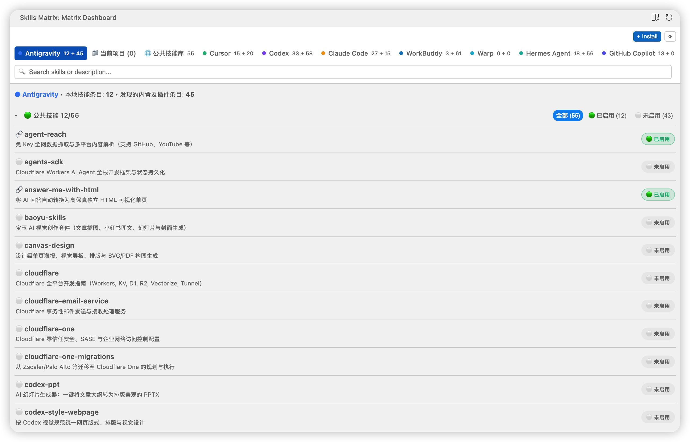

# Agent Skills Matrix

**简体中文** | [English](README_EN.md)

[](https://github.com/xdffish/agent-skills-matrix)
[](https://opensource.org/licenses/MIT)



Agent Skills Matrix 是一个用于查看和管理多个 AI Agent 技能目录的 VS Code 兼容扩展。它直接读取文件系统状态，并使用 `npx skills` 安装技能包。

## 功能

- **公共技能矩阵**：查看 `~/.agents/skills` 中的条目，并为已发现的 Agent 目录挂载或解除链接。外部链接、失效链接和实体目录会分别显示。
- **Agent 专属视图**：查看私有技能、公共池链接，以及扫描到的系统或插件技能。支持的插件目录通过本地缓存扫描，以只读方式展示。
- **当前项目**：只读浏览每个已打开的本地工作区文件夹下 `.github/skills`、`.agents/skills` 和 `.claude/skills` 中的技能，并保留来源路径。
- **技能集市**：浏览精选技能包，通过 `npx skills` 安装并选择目标 Agent。如果安装没有新增可识别的技能，可以选择已有公共技能进行挂载。
- **紧凑侧栏和编辑器面板**：从活动栏使用紧凑视图，或通过侧栏标题栏和状态栏在编辑器区域打开管理面板。
- **搜索和说明**：按名称或描述搜索，鼠标悬停可查看被截断的完整说明。

扫描结果只表示文件存在于磁盘上，**不代表**对应 Agent 或会话已经加载或启用该技能。插件缓存中可能包含未启用的版本。

## 支持的 Agent 目录

扩展检查当前用户主目录下的以下路径：

| Agent | 技能目录 |
| --- | --- |
| Antigravity | `~/.gemini/config/skills` |
| Cursor | `~/.cursor/skills` |
| Codex | `~/.codex/skills` |
| Claude Code | `~/.claude/skills` |
| WorkBuddy | `~/.workbuddy/skills` |
| Trae | `~/.trae/skills` |
| Warp | `~/.warp/skills` |
| Hermes Agent | `~/.hermes/skills` |
| GitHub Copilot | 优先使用 `~/.github/skills`，不存在时使用 `~/.copilot/skills` |

发现范围限于已实现的路径和缓存结构，目前不支持自定义路径。项目视图目前仅支持本地工作区文件夹。Windows 特定路径和目录联接行为尚未在 Windows 实机验证。

## 安装

在编辑器命令面板选择 **Extensions: Install from VSIX...**，然后选择打包生成的 `agent-skills-matrix-0.5.7.vsix`，也可以使用编辑器 CLI：

```bash
code --install-extension agent-skills-matrix-0.5.7.vsix
cursor --install-extension agent-skills-matrix-0.5.7.vsix
```

此安装包也已通过 Antigravity IDE CLI 在本机安装；其他 Antigravity 发行版本的兼容性尚未验证。更新后请重新加载编辑器窗口。

## 使用方法

1. 从活动栏打开 **Skills Matrix**。
2. 点击侧栏标题栏按钮或状态栏按钮，在编辑器区域打开更大的管理面板。
3. 在当前项目、公共池、技能集市和 Agent 视图之间切换。Antigravity 和 Cursor 默认打开各自的 Agent 视图，其他编辑器默认显示当前项目。
4. 在公共矩阵或 Agent 视图中管理链接；操作前检查同名冲突。

收编私有技能会将目录移动到公共池并创建链接。将同名实体副本转换为链接时，要求内容一致，并保留原目录备份。删除公共技能经确认后会删除其公共条目；如果解除链接失败，操作可能只完成一部分。请独立备份重要技能。

## 开发

```bash
npm install
npm run compile
npm run type-check
npm run vsce:package
```

`npm run watch` 会在文件变化时重新构建。`npm run test:cli` 会针对本地环境运行 CLI 检查程序。

## 许可证

MIT © [defuxu](https://github.com/defuxu)
