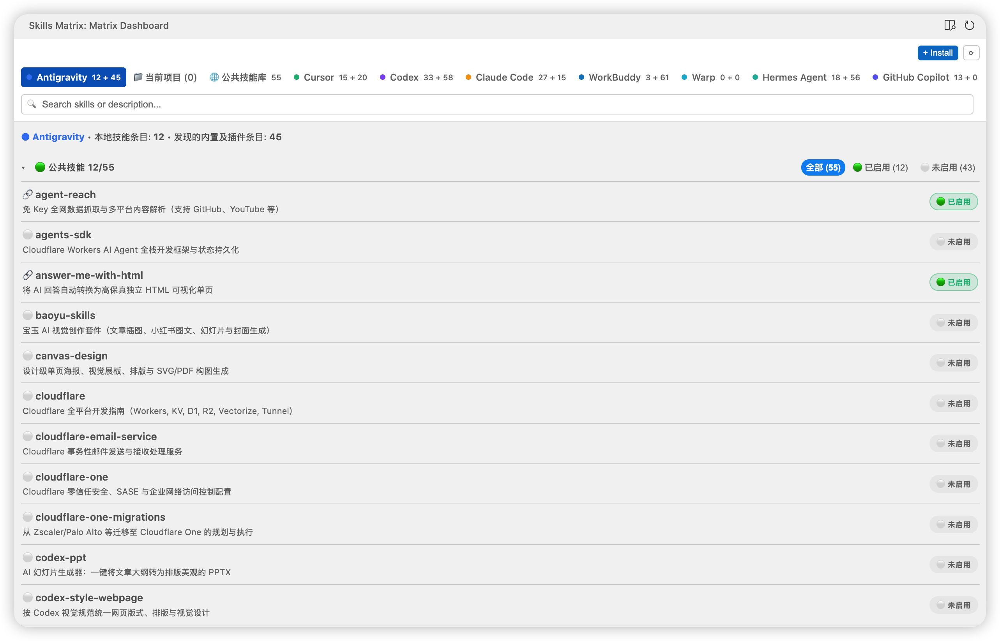

# Agent Skills Matrix

[简体中文](README.md) | **English**

[](https://github.com/xdffish/agent-skills-matrix)
[](https://opensource.org/licenses/MIT)



Agent Skills Matrix is a VS Code-compatible extension for inspecting and managing skill directories across multiple AI agents. It reads filesystem state directly and uses `npx skills` for package installation.

## Features

- **Public skills matrix:** Inspect entries in `~/.agents/skills` and connect or disconnect them from detected agent directories. External links, broken links, and physical directories are shown separately.
- **Agent views:** Inspect private skills, public pool links, and discovered built-in or plugin skills. Supported plugin locations are scanned from local caches and shown read-only.
- **Current project:** Browse skills found in `.github/skills`, `.agents/skills`, and `.claude/skills` under each open local workspace folder. Project entries are read-only and retain their source path.
- **Marketplace:** Browse curated packages, install through `npx skills`, and choose target agents. If the installation adds no identifiable new skill, you can choose existing public skills to mount.
- **Compact sidebar and editor panel:** Use the Activity Bar for a compact view, or open the dashboard in the editor area from the sidebar title or status bar.
- **Search and descriptions:** Search by name or description, and hover over truncated descriptions to read them.

Detected files indicate what exists on disk; they do **not** prove that a particular agent or session has loaded or enabled a skill. Cached plugin entries may include inactive versions.

## Supported agent directories

The extension checks paths relative to the current user's home directory:

| Agent | Skills directory |
| --- | --- |
| Antigravity | `~/.gemini/config/skills` |
| Cursor | `~/.cursor/skills` |
| Codex | `~/.codex/skills` |
| Claude Code | `~/.claude/skills` |
| WorkBuddy | `~/.workbuddy/skills` |
| Trae | `~/.trae/skills` |
| Warp | `~/.warp/skills` |
| Hermes Agent | `~/.hermes/skills` |
| GitHub Copilot | `~/.github/skills` if present, otherwise `~/.copilot/skills` |

Discovery is limited to implemented paths and cache layouts; custom locations are not currently configurable. The project view currently supports local workspace folders only. Windows-specific paths and junction behavior have not been verified on a Windows machine.

## Installation

The extension ID is `xdffish.agent-skills-matrix-vsc`, published on [Open VSX](https://open-vsx.org/extension/xdffish/agent-skills-matrix-vsc) and the [VS Code Marketplace](https://marketplace.visualstudio.com/items?itemName=xdffish.agent-skills-matrix-vsc). Install it by searching for **Agent Skills Matrix** in the Extensions view, or from the command line:

```bash
code --install-extension xdffish.agent-skills-matrix-vsc
cursor --install-extension xdffish.agent-skills-matrix-vsc
antigravity --install-extension xdffish.agent-skills-matrix-vsc
```

Alternatively, download `agent-skills-matrix-vsc-0.5.13.vsix` and use **Extensions: Install from VSIX...** in the Command Palette:

```bash
code --install-extension agent-skills-matrix-vsc-0.5.13.vsix
cursor --install-extension agent-skills-matrix-vsc-0.5.13.vsix
```

The earlier 0.5.10 release under the `denny` publisher and the old Open VSX ID `xdffish.agent-skills-matrix` are no longer updated. The old Open VSX listing is being submitted for deprecation with a replacement link to `xdffish.agent-skills-matrix-vsc`. The VS Code Marketplace permanently reserves the name of a removed extension, so the current extension ID carries a `-vsc` suffix. The VSIX package has also been installed locally with the Antigravity IDE CLI; compatibility with other Antigravity distributions has not been verified. Reload the editor window after an update.

## Usage

1. Open **Skills Matrix** from the Activity Bar.
2. Use the sidebar title action or status bar button to open the larger editor-area dashboard.
3. Switch between the current project, public pool, marketplace, and agent views. Antigravity and Cursor hosts default to their respective agent view; other hosts default to the current project.
4. Use the public matrix or an agent view to manage links. Review conflicts before changing them.

Promoting a private skill moves its directory to the public pool and creates a link. Converting a same-name physical copy requires matching contents and keeps a backup of the original directory. Removing a public skill deletes its public entry after confirmation; the operation may partially complete if unlinking fails. Keep independent backups of important skills.

## Development

```bash
npm install
npm run compile
npm run type-check
npm run vsce:package
```

`npm run watch` rebuilds on changes. `npm run test:cli` runs the CLI runner against the local environment.

When a push to `main` changes the version in `package.json`, GitHub Actions packages the extension and publishes it: to Open VSX when the `OVSX_PAT` secret is configured, and to the VS Code Marketplace once the `xdffish` publisher exists there (that step is skipped otherwise). The workflow can also be run manually from the Actions page.

## License

MIT © [defuxu](https://github.com/defuxu)
